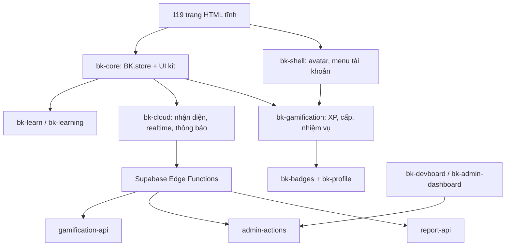

# System architecture

## Overview

Ba lớp, không có bước build:

1. **Nội dung tĩnh** — 119 tệp HTML (1 trang chủ, 1 admin, 116 trang môn/bài/Studio, 1 tệp rỗng) cộng `assets/`, `music/`, `images/`. Mỗi trang tự chứa nội dung giáo dục của nó.
2. **Lớp nâng cấp dùng chung** — các mô-đun `assets/bakhi/bk-*.js|css` được chèn bằng thẻ `<script>` (công cụ `tools/integrate-pages.js` chỉ chèn thẻ, không sửa nội dung). Mỗi mô-đun sở hữu một mối quan tâm duy nhất.
3. **Máy chủ tuỳ chọn** — Supabase: migrations (schema + RLS + realtime) và 11 Edge Function; `gamification-api`, `admin-actions`, `report-api` là các cửa ghi duy nhất.

## Module graph

## Constraints

- Không build, không framework, không bundler; ES5-ish + DOM thuần.
- Toàn bộ dữ liệu người dùng đi qua `BK.store`, một key duy nhất `bakhiLearn.v1`.
- Supabase là nguồn sự thật cho XP/cấp/thành tích; bảng người dùng chỉ có policy SELECT.
- Lớp máy chủ là `window.BKCloud`, không phải `BK.cloud`.
- Nội dung giáo dục bất biến — xem [[content-integrity-invariant]].
- Chi tiết đầy đủ: `docs/ARCHITECTURE.md`.
