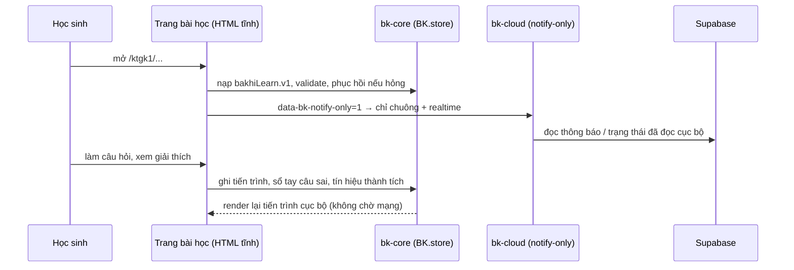

# Key flows

## End-to-end path of a typical request

Học sinh mở một trang bài học trên GitHub Pages:

## Other important flows

- **Đồng bộ tiến trình (trang chủ, chế độ đầy đủ):** `bk-cloud` nhận diện học sinh → đẩy sự kiện học tập + idempotency key lên `gamification-api` → máy chủ cộng XP trong transaction và gọi `bk_gam_evaluate`.
- **Trao thành tích của Founder:** dashboard → `admin-actions` → hàm `bk_gam_grant_*`, kiểm tra scope ở máy chủ.
- **Report Issue:** nút nổi (kéo được, neo trên chuông) → `report-api`; quản trị xử lý ở tab Report của `bk-devboard`.
- **Chèn lớp nâng cấp vào trang mới:** `tools/integrate-pages.js` → `tools/inject-favicon.js` → `node tools/content-integrity.js verify`.
