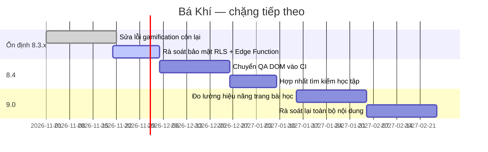

# Roadmap

## Milestones

Mốc dưới đây là kế hoạch **tạm thời**, suy ra từ trạng thái hiện tại (8.3.8, tháng 11/2026) — không phải cam kết phát hành.

## Ghi chú

- Không đưa mốc "thi thử/tính giờ" vào roadmap — xem [[no-exam-timers]].
- Mọi thay đổi hành vi vẫn phải có mục trong `CHANGELOG.md` và giữ [[content-integrity-invariant]] xanh.
