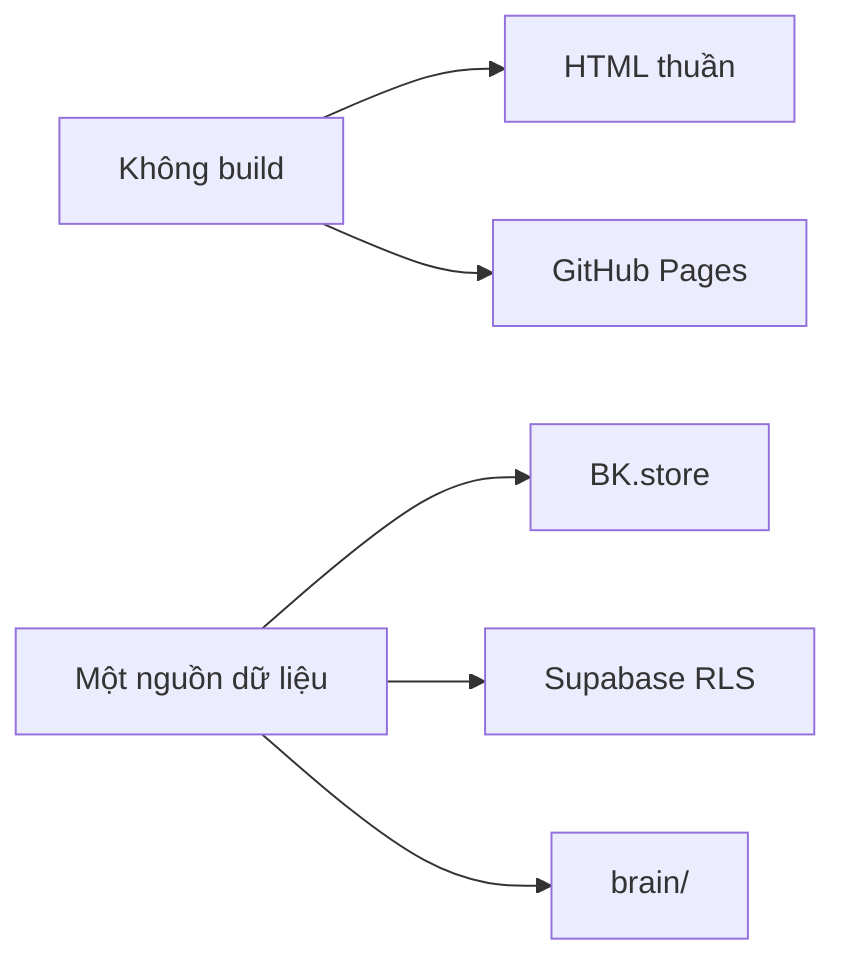

# Tech stack

## Technology choices

| domain | candidates | decision | rationale |
|---|---|---|---|
| Giao diện | React/Vue + bundler, HTML thuần | **HTML/CSS/JS thuần, không build** | Deploy GitHub Pages trực tiếp; sửa một tệp là xong, không có bước dựng nào có thể hỏng |
| Dữ liệu cục bộ | localStorage rời rạc, IndexedDB, một store có schema | **`BK.store` — một key `bakhiLearn.v1` có `v` phiên bản + validate + phục hồi** | Tránh phân mảnh dữ liệu; nâng cấp schema có đường lùi |
| Backend | tự viết server, Firebase, Supabase | **Supabase (Postgres + RLS + Edge Functions)** | RLS giữ dữ liệu học sinh ở phía máy chủ; Edge Function là cửa ghi duy nhất |
| Xác thực | tự quản lý tài khoản, Supabase Auth | **Supabase Auth, nhận diện là tuỳ chọn** | Học sinh đọc nội dung mà không cần đăng nhập |
| XP/thành tích | tính ở client, tính ở máy chủ | **máy chủ (`bk_gam_*`) + idempotency key** | Client không thể tự cộng XP; xem [[gamification-server-authority]] |
| QA | thủ công, jsdom | **jsdom 31.0.1 ghim + `tools/qa/*` + content-integrity** | Không thêm dependency runtime; jsdom chỉ cài ngoài repo vào `/tmp/bktest` |
| Trí nhớ dự án | chỉ AGENTS.md, brain.md | **brain.md trong `brain-toolkit/` + `brain/`** | Xem [[brain-toolkit-location]] |

## Decision mindmap

## Open items

- Chưa có kiểm thử tự động chạy trong CI cho smoke DOM (hiện chạy tay qua `tools/qa/*`).
- jsdom phải cài ngoài repo — chưa có cách chạy QA chỉ với Node thuần.
